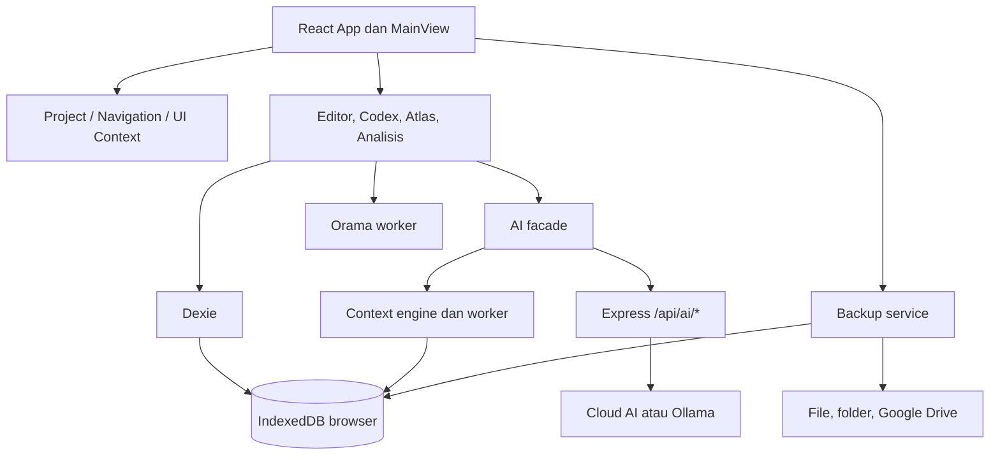
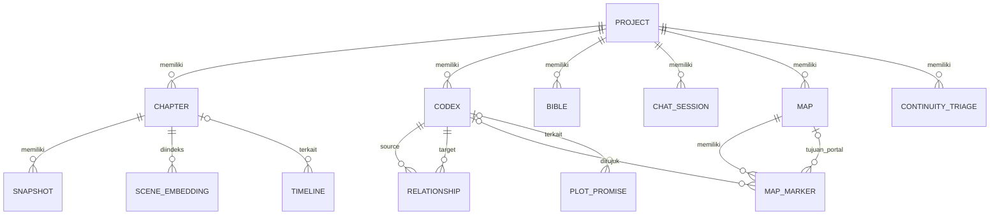

# Audit Aplikasi AetherScribe — 9 November 2026

> **Jenis:** snapshot analisis, bukan implementasi perbaikan.  
> **Konteks:** aplikasi pribadi, single-user, local-first.  
> **Baseline source:** `a47f895a47a633f02f95511192bddfa47397bef2` (working tree source bersih saat audit).  
> **Pelacakan kerja:** [ROADMAP.md](../../ROADMAP.md#audit-2026-11-09).  
> **Rincian temuan:** [register F01–F29](2026-11-09-findings.md).

Laporan ini menyimpan hasil investigasi pada sesi audit sebelumnya. Hasil build, test, dan probe di bawah berasal dari sesi tersebut; tidak diklaim sebagai pengujian ulang saat dokumentasi ditulis. Tidak ada perbaikan source, migrasi, akses IndexedDB pengguna, pemanggilan provider/Drive, deployment, atau eksploitasi destruktif dalam audit. Build verifikasi dibuat di direktori sementara OS. Nomor baris merujuk baseline dan dapat bergeser setelah perbaikan.

## 1. Executive Summary

AetherScribe memiliki fondasi modular yang sesuai untuk aplikasi novel pribadi, tetapi reliabilitas antarfiturnya belum sebanding dengan keluasan fitur. Ditemukan **29 temuan: 5 High, 21 Medium, dan 3 Low**, tanpa bukti cukup untuk menetapkan Critical/P0.

Risiko utama:

1. **F03:** restore backup internal membuang gambar Atlas; snapshot pra-restore juga mengecualikan gambar.
2. **F05:** kegagalan save editor tidak diteruskan ke pemanggil `flush()`, sehingga operasi berikutnya dapat memakai data lama.
3. **F01:** judul marker/nama Codex masuk ke HTML Leaflet tanpa pengamanan.
4. **F02:** proxy bind `0.0.0.0`, dapat memakai key environment, dan menerima tujuan Ollama dari request.
5. **F04:** service restore tidak menegakkan scope dan schema record dengan cukup kuat.

Duplikasi bab, setter triage kontinuitas, dan bagian Codex pada pencarian gabungan juga mempunyai bug konkret. Typecheck, build, dan **473 tes dalam 43 berkas** lulus; mayoritas tes belum melintasi integrasi editor–database–backup yang bermasalah.

Prioritas berikutnya adalah stabilisasi penyimpanan, recovery, batas proxy, indeks, dan lifecycle AI. Tidak dibutuhkan microservices, akun multi-user, atau RBAC untuk menyelesaikan temuan ini.

## 2. Application Overview

| Aspek | Hasil |
|---|---|
| Nama | AetherScribe; metadata package masih `react-example` |
| Tujuan | Penulisan novel, worldbuilding, kontinuitas, analisis, bantuan AI |
| Bentuk | React SPA/PWA dengan Express sebagai proxy/server frontend |
| Penyimpanan | IndexedDB browser melalui Dexie; bukan database server |
| Pengguna | Satu pengguna dengan banyak proyek lokal |
| Navigasi | `viewMode` melalui React Context, bukan URL router |
| Eksternal opsional | Provider AI, Ollama, Google Identity Services, Google Drive |
| Recovery | Backup internal, file, folder lokal, Drive |

Entry point: [main.tsx](../../src/main.tsx), [App.tsx](../../src/App.tsx), [server.ts](../../server.ts). Mengakses server dari perangkat/browser lain tidak memberikan database novel yang sama: IndexedDB terikat origin dan profil browser.

## 3. Technology Stack

| Lapisan | Teknologi/versi lokal yang diperiksa |
|---|---|
| Runtime audit | Node.js 24.15.0, npm 11.12.1 |
| Bahasa | TypeScript/TSX, CSS |
| UI | React 19.2.6, Tailwind CSS 4, Lucide, Motion |
| Build | Vite 6.4.2, esbuild, Workbox/PWA |
| Editor | TipTap 3.22.5, ProseMirror |
| Database | Dexie 4.4.2, IndexedDB |
| Backend | Express 4.22.1 |
| Search/AI lokal | Orama, Xenova Transformers, js-tiktoken, Web Workers |
| Visual | Leaflet 1.9.4, React Flow, force graph |
| Ekspor | DOCX, jsPDF, utilitas EPUB/ZIP |
| Tes | Vitest 4.1.8 |

Versi ini bukan klaim versi terbaru. Konfigurasi: [package.json](../../package.json), [vite.config.ts](../../vite.config.ts), [tsconfig.json](../../tsconfig.json).

Nama environment yang dirujuk: `GEMINI_API_KEY`, `GROQ_API_KEY`, `OPENAI_API_KEY`, `OPENROUTER_API_KEY`, `HF_API_KEY`/`HUGGINGFACE_API_KEY`, `CLAUDE_API_KEY`, `NODE_ENV`, `DISABLE_HMR`. `HAS_GEMINI_KEY` adalah boolean build-time, bukan nilai key. `APP_URL` ada dalam contoh konfigurasi tetapi tidak ditemukan dipakai; port server hardcoded 3000, bukan membaca `PORT`. Entry point server tidak memuat `.env` secara eksplisit (F21).

Firebase ada sebagai dependency/config, tetapi autentikasi runtime yang ditelusuri memakai Google Identity Services. Tidak ditemukan import runtime Firebase pada source yang diperiksa; ini belum cukup untuk menghapus dependency tanpa pemeriksaan peer/transitive dependency.

## 4. Repository Structure

```text
server.ts                 Proxy AI dan penyajian frontend
src/main.tsx, App.tsx      Bootstrap, providers, shell
src/db.ts, types.ts        Schema dan model lintas domain
src/components/           Common, layout, modals, panels/settings
src/contexts/             Project, navigation, UI, editor panel
src/features/             Editor, chapters, codex, codex-workshop,
                          lore, atlas, timeline, consistency,
                          assistant, search
src/hooks/                Backup, indexing, query, sesi, lifecycle
src/services/             AI, backup, Drive, context/worker, RAG
src/lib/                  Algoritme murni dan mayoritas tes
src/workers/              Worker khusus
public/                   Aset PWA
docs/                     Referensi modular, audit, arsip
```

Inventaris sekitar 291 berkas TS/TSX termasuk 43 berkas tes, sekitar 56.843 baris termasuk komentar dan tes. Angka bukan ukuran coverage. Folder materi pribadi `bahan-dunia/` tidak digunakan sebagai bahan audit.

### Penyesuaian terhadap dokumentasi yang sudah ada

Dokumentasi modular dipertahankan: [overview](../overview.md), [architecture](../architecture.md), [features](../features.md), [database](../database.md), [api](../api.md), [decisions](../decisions.md), [changelog](../changelog.md). Keputusan konsolidasi 2026-10-07 menjadikan `ROADMAP.md` satu-satunya tracker aktif. Karena temuan baru belum diperbaiki, laporan ditempatkan di `docs/audits/`, bukan `docs/archive/`.

| Catatan lama | Konteks hasil audit baru |
|---|---|
| Arsip audit menyatakan seluruh pekerjaan berdampak selesai | Pernyataan historis tidak membuktikan bebas regresi pada baseline sekarang; F01–F29 menjadi evaluasi baru |
| ADR 2026-06-21 menempatkan hardening proxy di luar scope | F02 merekomendasikan batas loopback/tujuan Ollama yang sederhana karena bind aktual semua antarmuka; tidak meminta keamanan enterprise |
| ADR 2026-07-06 sengaja mengeluarkan gambar dari auto-backup | Penghematan kuota dipahami; masalah F03 adalah restore menghapus aset yang masih ada dan pre-restore juga tidak lengkap |
| Katalog menyebut autosave menjamin kata terakhir tersimpan | Listener hide/visibility memang ada; F05 menunjukkan kegagalan save tetap tidak diteruskan |
| Katalog menyebut triage dan federated search selesai | F07/F08 menemukan ketidakcocokan schema/lifecycle instance pada implementasi sekarang |
| Dokumentasi menyebut 60 FPS/zero freezing | Tujuan desain, bukan benchmark yang dibuktikan audit |
| Arsitektur mencantumkan `PORT`/`APP_URL` sebagai konfigurasi | Implementasi sekarang belum memakai keduanya sebagaimana deskripsi (F21) |
| ADR BYOK menyebut proxy hanya meneruskan key klien | Implementasi juga memiliki fallback key environment; relevan terhadap F02 |

Ada rujukan path lama dalam dokumentasi, misalnya worker lore graph yang sebenarnya berada di `src/workers/loreGraphWorker.ts`, hook chat di `src/hooks/useChatSession.ts`, serta snapshot diff di fitur editor. Saat implementasi perbaikan nanti, selaraskan dokumen modul yang tersentuh dengan source; jangan menganggap referensi historis sebagai bukti runtime. ADR lama tidak diubah menjadi keputusan baru yang belum diimplementasikan.

## 5. Architecture Overview



Pola utama: frontend modular berdasarkan fitur, Dexie diakses langsung dari hook/komponen, service layer pada AI/backup/worker. Context menggantikan state manager terpusat; tidak ada URL router. Banyak panel lazy-loaded, algoritme murni dapat diuji, dan worker sudah digunakan.

Coupling terbesar: kebijakan operasi data tersebar; penambahan tabel/FK perlu sinkron manual pada importRemap, deleteProject, dan backupService. Proyeksi list dapat keliru dipakai sebagai record lengkap (F06). Kontrak worker tidak konsisten (F16). Error ditangani campuran throw/toast/console/ignore. Tidak ditemukan siklus pada graf import/export statis yang dianalisis; dependensi dinamis/perilaku tidak otomatis tercakup.

## 6. Feature Inventory

**Implemented (logika)** berarti ada pengujian lokal relevan terhadap logika tersebut, bukan jaminan UX. **Unable to Verify** berarti implementasi ditelusuri tetapi browser/provider belum diuji. **Partially Implemented/Broken** dibatasi ke bagian yang disebutkan.

| Fitur/tujuan | Entry/UI → service/alur | Data/API/dependensi | Validasi/error dan status |
|---|---|---|---|
| Proyek | ProjectManagerModal → ProjectContext → Dexie | projects dan turunannya | Transaksi delete; UI Unable to Verify, F11 |
| Naskah | NovelEditor → useEditorSave → update | chapters, editorBridge | Debounce/status/flush; Partially Implemented, F05 |
| Bab/outline | ChapterList/OutlinePanel → CRUD/reorder | chapters | Konfirmasi hapus; duplicate Broken, F06/F11 |
| Snapshot/diff | SnapshotPanel → snapshotService/diff | snapshots, chapters | Logika diff Implemented; recovery UI Unable to Verify |
| Find/replace | SearchReplaceBar/CrossChapterReplace → flush/transaksi/reload | chapters | Preview/konfirmasi; Partially Implemented, F05 |
| Ekspor | ExportManager → MD/PDF/DOCX/EPUB | chapters, projects | Pemilihan bab/pembersihan notes; EPUB/ZIP logic Implemented, reader Unable to Verify, F19 |
| Codex | CodexPanel/Form → useCodexPanel → Dexie | codex, categories, relationships | Nama wajib; UI Unable to Verify, F09/F11 |
| Kategori/field | CategoryManagerModal → kategori/field helpers | codexCategories, codex | Unik proyek+slug; helper tests, UI Unable to Verify |
| Impor/ekspor Codex | Parser → normalisasi → simpan | codex | Parser/field tests Implemented; F01 pada render nama |
| Name Forge | NameForgeModal → generator | codex opsional | Algoritme Implemented; UI Unable to Verify |
| Story Bible | BiblePanel → hook → autosave/AI | bible, proxy opsional | Unik proyek+key; error sebagian console; Unable to Verify |
| Faksi | FactionsPanel/board → useFactions | codex/tag/faction metadata | Domain tests Implemented; board Unable to Verify |
| Relasi/graf | RelationshipMapper/LoreGraphPanel → worker | relationships, codex | Transformasi graf Implemented; UI Unable to Verify |
| Kelengkapan/orphan | WorldCompleteness/CodexHealth → checker | codex, relasi, naskah | Deterministik Implemented; bukan FK constraint |
| Atlas | AtlasPanel → MapCanvas/useAtlas | maps, mapMarkers, codex | Raster/ukuran/geometri; Partially Implemented, F01/F03/F11 |
| Timeline | TimelinePanel → event CRUD | timeline, bab, codex | Kronologi logic Implemented; UI Unable to Verify |
| Kalender | WorldCalendarPanel/calculator/editor | project.calendar, timeline | Validasi/perhitungan Implemented; UI Unable to Verify |
| Kontinuitas | ContinuityDashboard → analisis → triage | continuityTriage, bab, codex | Analisis Implemented; setter Broken, F07 |
| Konsistensi AI | ConsistencyPanel/hooks → AI facade | POST /api/ai/proxy | Min teks, batas 48.000 karakter, normalisasi; provider Unable to Verify |
| Glosarium/ejaan | GlossaryPanel/hooks → checker | glossary, codex, naskah | Logika Implemented; UI Unable to Verify |
| Prosa/pacing/arc/promises | Panel analisis → fungsi domain | bab, codex, plotPromises | Unit tests Implemented; UI Unable to Verify |
| Search/RAG | GlobalSearch/SemanticSearchPanel → Orama/embedding | codex, sceneEmbeddings | Loading/error/rebuild; Partially Implemented, Codex gabungan Broken F08/F09 |
| Assistant/chat | Assistant → useChatSession → AI → sesi | chatSessions, proxy | Retry/abort/error UI; layanan Unable to Verify, F12/F14/F17 |
| Rewrite/actions | ActionsPanel/selection → useEditorAI → preview/apply | aiActions, editor, snapshots, proxy | Review/snapshot; Partially Implemented F14/F15 |
| Workshop | CodexWorkshopPanel → draft/review/save | codex, chatSessions, proxy | Nama/deskripsi wajib; layanan Unable to Verify, F10 |
| Ringkasan otomatis | useAutoSummarizer → proxy → summary | chapters | Guard panjang/in-flight; Partially Implemented F29 |
| Backup/restore | Settings → backupService → file/folder/Drive | 15 tabel konten, backup store | Checksum/kompresi/transaksi; Partially Implemented F03/F04/F10/F19/F20 |
| Settings/log/dashboard | Panels → storage/query/service | errors, aiUsageLogs, projects | Status/tes koneksi; layanan Unable to Verify F21/F27 |
| PWA | Workbox → precache | Aset aplikasi | Build lulus; offline/update Unable to Verify |

Mode legacy `arc`/`orphans` masih diterima oleh navigasi tetapi tidak memiliki cabang tampilan mandiri yang sesuai (F26); fungsi domainnya tidak otomatis hilang.

## 7. Frontend Analysis

Enam studio didefinisikan di [studioNavigation.ts](../../src/lib/studioNavigation.ts): Menulis, Dunia & Lore, Visual & Peta, Analisis & Naskah, Asisten AI, Sistem. State UI/context dipisahkan, live query menghubungkan Dexie ke render, dan preferensi navigasi disimpan lokal. Editor diberi key berdasarkan bab; audit tidak menyimpulkan race pergantian bab hanya dari keberadaan hook.

Loading/error/empty state tersedia namun belum seragam. Error boundary melindungi error render, bukan seluruh rejection asynchronous. Kelas responsif tersedia tetapi layout nyata belum diuji. ConfirmDialog belum memiliki role/ARIA/focus trap/restoration/Escape lengkap (F25).

Lazy loading sudah luas, tetapi editor ada pada jalur awal dan ActionsPanel diimpor statis sekaligus dinamis. Virtualisasi list tidak mengurangi volume query seluruh isi bab (F23). Race/lifecycle utama: F05 save, F14 buffer retry, F15 interval, F29 ringkasan.

## 8. Backend & API Analysis

Semua handler berada di [server.ts](../../server.ts), tidak memiliki autentikasi aplikasi/RBAC, dan tidak mengoperasikan database novel.

| POST endpoint | Baris handler | Request | Response/error |
|---|---:|---|---|
| `/api/ai/proxy` | 26 | provider, body, ollamaBaseUrl?, x-api-key? | JSON provider/SSE, 400 provider invalid, upstream error/500 |
| `/api/ai/google-models` | 159 | Key header atau env | Daftar model; 400 tanpa key/upstream error |
| `/api/ai/groq-models` | 184 | Key header atau env | Daftar model/error |
| `/api/ai/openai-models` | 209 | Key header atau env | Daftar model/error |
| `/api/ai/huggingface-models` | 234 | Key header atau env | Daftar model/error |
| `/api/ai/claude-models` | 259 | Key header atau env | Daftar model/error |
| `/api/ai/ollama-models` | 285 | baseUrl? | Daftar model lokal/error |

Body limit 25 MB bukan schema validation. Key header menggantikan fallback env. Tidak ada rate/concurrency limit atau allowlist tujuan Ollama. Operasi string sebelum try menyebabkan rejection tak tertangani (F18); Express 4 memerlukan error handling async eksplisit. Daftar model tidak mempunyai timeout eksplisit setara client utama. `res.write` stream tidak menangani backpressure. Error parser/middleware/handler tidak selalu mempunyai schema yang sama.

Tidak ditemukan antrean backend, scheduler, upload server, atau CRUD novel. Risiko aktual bukan IDOR antarpengguna, melainkan penggunaan proxy/key dari caller yang dapat menjangkau server (F02).

## 9. Database Analysis

[db.ts](../../src/db.ts) mendefinisikan AetherScribeDB v33, 20 store:

| Kelompok | Store |
|---|---|
| Proyek/naskah | projects, chapters |
| Lore | codex, bible, codexCategories |
| Relasi/waktu | relationships, timeline |
| AI | aiActions, chatSessions, aiUsageLogs |
| Recovery | snapshots, backups |
| Cache | embeddings, sceneEmbeddings |
| Analisis | plotPromises, glossary, continuityTriage |
| Atlas | maps, mapMarkers |
| Diagnostik | errors |

Indeks unik: bible `[projectId+key]`, kategori `[projectId+slug]`. Scene embedding memiliki `[projectId+chapterId]`. Triage hanya `projectId` dan `findingId` terpisah, bukan compound index yang dipakai setter.



ERD adalah relasi logis; tidak ada penegakan foreign key otomatis. Restore atomik pada 17 store (15 konten + dua cache embedding) tidak menjamin input semantik benar. Delete proyek melakukan cascade luas, delete bab tidak setara; reorder memakai update terpisah. Tidak ada jaminan soft-delete/audit trail menyeluruh; snapshot adalah recovery bab, bukan catatan seluruh mutasi.

Rantai migrasi v10–v33 tersedia, tetapi upgrade nyata dari setiap versi lama belum diuji. Full backup tidak memuat embeddings, sceneEmbeddings, errors, aiUsageLogs, backups, atau key localStorage. Ekspor proyek melewatkan triage. Internal backup berada pada media kegagalan sama dengan DB utama; bukan perlindungan kehilangan profil/perangkat. Tidak ada klaim database pengguna saat ini sudah rusak.

## 10. Security Audit

Penilaian berbasis penggunaan pribadi. Severity teknis dipisahkan dari prioritas. Detail file/bukti/mitigasi setiap ID ada di register.

### A. Must Fix

| ID | Technical severity | Exploitability / actual exposure | Personal use risk | Priority |
|---|---|---|---|---|
| F01 | High | Nama/judul dari input/impor mencapai HTML Leaflet; sink source terkonfirmasi, browser belum diuji | Script origin dapat membaca/mengubah naskah dan storage key | P1 |
| F02 | High | Bind semua antarmuka terkonfirmasi; LAN bergantung firewall, internet unknown | Pemakaian key server dan request ke tujuan dari caller | P1 |
| F03 | High | Restore normal; direproduksi dengan DB mock | Aset peta hilang; snapshot pengaman juga tidak utuh | P1 |
| F04 | High | Core menerima scope/record minimal; guard sebagian hanya UI | Workspace terganti subset/data invalid | P1 |
| F05 | High | DB gagal/record hilang; hook mock terkonfirmasi | Draft terbaru berisiko tertimpa operasi lanjut | P1 |
| F18 | Medium | Input salah tipe menyebabkan rejection sebelum error handler | Gangguan server; dampak meningkat jika LAN reachable | P1 |

Mitigasi sederhana: DOM/textContent untuk Atlas; server loopback dan tujuan Ollama yang dibatasi; schema input di service; save failure menghentikan operasi berikutnya. Tidak diperlukan RBAC.

### B. Recommended

- F17: mode local-only dan izin fallback cloud eksplisit; key tersimpan bukan izin universal mengirim semua konteks ke provider lain.
- F27: minimalkan prompt di log, tawarkan key session-only, jelaskan Base64 bukan enkripsi.
- F04: batasi ukuran file/hasil dekompresi/jumlah record; `blobCodec.ts:22–24` melakukan fetch atas string impor, sehingga perlu allowlist data URL gambar. Ini request browser (CORS berlaku), bukan SSRF server.
- Dependency advisory belum diperiksa karena memerlukan sumber eksternal; tidak ada klaim bebas CVE.

### C. Acceptable Risk, bersyarat

Tidak ada akun/RBAC dapat diterima untuk satu pengguna setelah batas proxy diperbaiki. Plaintext IndexedDB dapat diterima pada perangkat/profil OS tepercaya; penilaian berubah pada perangkat bersama atau ancaman pencurian profil. Penyimpanan key lokal adalah pilihan kenyamanan bersyarat setelah XSS ditutup, bukan perlindungan kriptografis. Token Google disimpan di memori dan scope mencakup drive.file/profile, tetapi script origin tetap menjadi ancaman. SIEM/WAF/keamanan enterprise tidak diperlukan.

Tidak ditemukan backend SQL/NoSQL atau upload file server yang relevan. Upload Atlas membatasi raster/ukuran dan menolak SVG pada jalur normal. ReactMarkdown yang ditelusuri tidak memakai rehypeRaw; TipTap schema tidak mengamankan sink Leaflet terpisah. Tidak ada bukti CSRF lintas origin berhasil, dan XSS tidak otomatis berarti OS command execution. Tidak ditemukan secret tertanam pada source yang ditinjau; ini bukan scan seluruh riwayat Git.

## 11. Performance Analysis

| Pengukuran build lokal | Hasil |
|---|---:|
| Vite duration / modules | 20,74 detik / 4.275 |
| JS utama | 2.006,61 kB; gzip 623,60 kB |
| Context worker | 6.559,55 kB |
| Orama / lore graph worker | 171,29 / 5,60 kB |
| CSS | 239,11 kB; gzip 30,36 kB |
| Precache | 89 entri, 10.851,97 KiB |

Warning: chunk besar, import statis/dinamis ActionsPanel, eval pada dependency ONNX, data compatibility browser lama. Warning bukan bukti CVE atau latency pengguna.

Indikasi source: ChapterList membaca seluruh content dan menghitung kata; auto semantic index membaca bab untuk timestamp; query wrapper membandingkan JSON; semantic search menghitung similarity/sort seluruh embedding proyek; backup mengubah Blob menjadi Base64 sebelum internal backup membuangnya; satu worker menangani beberapa jenis tugas. F15 menunjukkan timer berulang pada kegagalan. Startup, FPS, heap, latency mengetik, dan pencarian dataset besar belum diukur.

## 12. Code Quality & Technical Debt

Panel besar: AtlasPanel ~1.318 baris, BiblePanel ~1.124, WorldCalendarPanel ~1.027; AI facade ~864, MapCanvas ~855, OutlinePanel ~824, ConsistencyPanel ~808. Ukuran bukan bug sendiri, tetapi tanggung jawab UI/data/validasi sering bercampur.

`strict` TypeScript belum aktif; `lint` hanya typecheck. Scan leksikal menemukan ~238 kemunculan any dan lima ts-ignore/ts-nocheck, bukan persentase coverage/type safety. Kandidat dependency tanpa import langsung harus diverifikasi sebelum penghapusan. Metadata aplikasi belum konsisten. Refactor boundary save/import/worker dan operasi domain lebih bernilai daripada memecah JSX semata (F28).

## 13. Testing & Reliability

| Pemeriksaan sesi audit | Hasil | Batas |
|---|---|---|
| npm run lint | Lulus | Typecheck konfigurasi sekarang |
| Vitest run | 43 berkas / 473 tes lulus; sekitar 2,83 detik | Mayoritas utilitas/domain murni |
| Vite + esbuild server | Lulus, output OS temp | Bukan verifikasi startup production |
| Git akhir audit | Bersih | Tidak ada perubahan source |
| Browser, DB nyata, migration, provider, Drive | Tidak dijalankan | Masih verification gaps |

Probe memakai source asli yang ditranspilasi, dependency/mock DB/fetch, dan fixture sintetis, tanpa file tes persisten atau data pengguna:

| Probe | Hasil |
|---|---|
| Duplicate bab isi 26 karakter | Salinan isi 0 |
| Save reject / update 0 baris | Flush resolve / status Tersimpan |
| Internal/pre-restore dengan gambar | Gambar dibuang, map hasil restore tanpa Blob |
| Restore scope project dengan record minimal | Diterima, 17 store clear pada mock |
| Codex ID remap 10→20 | workshopKey tetap entry:10 |
| SSE error provider | Sukses kosong |
| Claude usage start/delta | Input/cache awal tertimpa |
| Temperature 0 | Payload 0,7 |
| Model/baseUrl angka | Handler reject sebelum respons terkelola |

Tidak ditemukan coverage config/CI yang membuktikan pemeriksaan otomatis tiap perubahan. Probe bukan pengganti IndexedDB/browser integration test (F24).

## 14. DevOps & Deployment

Build: Vite frontend + esbuild `server.ts` menjadi `dist/server.cjs`; start menjalankan node. F21: start tidak menetapkan production, Vite top-level import adalah devDependency, `.env` tidak dimuat server, port hardcoded. Instalasi production bersih belum diuji.

Tidak ditemukan CI/CD, Dockerfile, health endpoint khusus, atau rollback deployment yang dapat diverifikasi. Node minimum tidak ditegakkan via engines; clean `rm -rf` tidak portabel di semua shell Windows. PWA auto-update perlu pengujian bersama editor aktif dan migrasi. Docker/monitoring enterprise opsional; startup deterministik dan recovery tetap penting.

## 15. Cross-Module Data Flow

| Alur | Transformasi/validasi | Kegagalan dan penanganan |
|---|---|---|
| Menulis | TipTap HTML → debounce 1,5 detik → chapters.update → live query | Status gagal ada tetapi rejection ditelan F05 |
| Replace global | Preview/konfirmasi → flush → baca → transaksi replace → reload | Flush gagal tidak menghentikan pembacaan data lama |
| Duplikasi | Query entitas → content dikosongkan pada proyeksi → add | Tidak mengambil ulang record lengkap F06 |
| Rewrite | Selection → Bible/Codex/RAG → facade → proxy → provider → SSE → preview/apply | Error frame/retry/lifecycle/fallback F12/F14/F15/F17 |
| Codex indexing | Form valid → add → creating hook → worker → Orama | Generated key belum tersedia F09 |
| Federated search | Query → embedding + Orama → gabung → navigasi | Instance Orama main thread tidak init F08 |
| Atlas | Raster valid → Blob DB → object URL → Leaflet; marker → label | HTML label F01; Blob recovery F03 |
| Backup/restore | Tabel → Base64/envelope/checksum/gzip → storage → decode → replace transaction | Validasi/snapshot/aset F03/F04/F19 |
| Impor proyek | Envelope → ID baru → remap → insert transaction | Triage/workshop key tertinggal F10 |
| Drive | OAuth → collect → prune → upload | Upload gagal setelah retensi menyusut F20 |

## 16. Critical Findings

Istilah bagian mengikuti struktur audit; **tidak ada severity Critical**. Lima High adalah [F01](2026-11-09-findings.md#f01), [F02](2026-11-09-findings.md#f02), [F03](2026-11-09-findings.md#f03), [F04](2026-11-09-findings.md#f04), dan [F05](2026-11-09-findings.md#f05). Prioritas operasional pertama: data/recovery dan keamanan origin/proxy. Semua rincian bukti, batas confidence, file/baris, serta acceptance criteria tersedia di register.

## 17. Complete Issue Register

[Register lengkap F01–F29](2026-11-09-findings.md) menyimpan severity, modul, lokasi, description, evidence, impact, recommendation, confidence, verification method, effort, dependency, risiko perubahan, dan kriteria penerimaan. ID sama dengan laporan percakapan agar rujukan pekerjaan tidak berubah. Status pengerjaan hanya di ROADMAP, bukan di snapshot audit.

## 18. Improvement Recommendations

1. Save harus gagal secara eksplisit; operasi lanjut menunggu keberhasilan yang benar.
2. Recovery aset dipisahkan dari kebijakan penghematan backup; backup parsial tidak boleh diam-diam menghapus aset.
3. Schema validation pada boundary API/import/worker, bukan hanya form UI.
4. Label Atlas melalui DOM aman; batas proxy default loopback dan tujuan Ollama yang diizinkan.
5. Local-only AI dan fallback cloud menjadi pilihan eksplisit.
6. Tes lintas modul untuk save→replace, duplicate, backup→restore, remap→consumer, add Codex→index→search.
7. Benchmark dataset sintetis sebelum optimasi besar.
8. Service operasi domain dan tipe metadata/entitas terpisah sebelum refactor kosmetik.

## 19. Prioritized Roadmap

Estimasi untuk satu pengembang yang memahami repo, bukan tenggat; kelompok dapat tumpang tindih. Tiap finding memiliki dependency/risiko/acceptance di register.

| Horizon | Tujuan/ID | Modul dan dependency | Risiko/effort | Verifikasi |
|---|---|---|---|---|
| Immediate 0–2 hari | Pengamanan data F03/F05; XSS/proxy F01/F02/F18 | Backup, editor bridge, Atlas, server; fixture aman | Sedang, sekitar 2–5 hari kerja total; mulai dalam horizon ini | Blob round-trip; save gagal menghentikan replace; label teks; invalid API 4xx |
| Short term 3–14 hari | Restore/round-trip F04/F10/F19; fungsi inti F06–F09/F11 | Schema backup, domain DB, Orama; F05 mendahului F19 | Sedang–tinggi, sekitar 5–9 hari | Semua tabel/reference round-trip; duplicate/triage/search benar |
| Short term 3–14 hari | AI F12–F17/F29, Drive F20, runtime F21 | Fixture stream, pesan worker, mock Drive, environment bersih | Sedang, sekitar 4–8 hari | Error/retry/abort deterministik; local-only; upload sebelum prune; start production |
| Medium 2–6 minggu | QA F24, bundle/query F22/F23, UX F25/F26 | Harness DB/browser dan baseline benchmark | Sedang, sekitar 10–18 hari | Regresi kritis di CI; metrik sebelum/sesudah; keyboard dan mode lama |
| Long 1–3 bulan | Privacy/maintainability F27/F28; lifecycle gaps | Tipe boundary stabil dan regression suite | Bertahap, effort L untuk refactor | Strictness bertahap, log minimal, migration/PWA/quota/multitab tests |

Mulai tes regresi F24 sejak batch pertama; horizon medium adalah penyempurnaan harness/CI, bukan menunda semua tes. [Checklist aktif](../../ROADMAP.md#audit-2026-11-09) menentukan urutan praktis. Effort per item tidak dijumlahkan sebagai jadwal pasti.

## 20. Final Assessment

| Dimensi | Penilaian |
|---|---|
| Arsitektur pribadi | Sesuai, local-first tetap layak |
| Logika deterministik | Relatif kuat dengan unit tests |
| Penyimpanan/recovery | Perlu perbaikan prioritas tinggi |
| Keamanan praktis | XSS dan batas jaringan perlu ditutup |
| AI | Fitur luas, streaming/retry/lifecycle belum kokoh |
| Performa | Bundle besar terukur; latency nyata unknown |
| Maintainability | Sedang, kontrak boundary longgar |
| Deployment | Build lulus; startup bersih belum terbukti |

Aplikasi belum layak menjadi satu-satunya tempat penyimpanan naskah penting tanpa cadangan eksternal yang telah diverifikasi. Audit tidak membuktikan data pengguna saat ini rusak atau server terekspos internet.

## 21. Unknowns & Verification Gaps

Audit statis lintas modul, typecheck/build/unit tests, dan probe terisolasi selesai; **validasi end-to-end belum ditutup**:

- Browser rendering, Atlas XSS execution, responsive, keyboard/screen reader.
- IndexedDB nyata: quota/eviction, transaction failure, multi-tab, penutupan mendadak.
- Migrasi setiap versi historis dan restore database representatif.
- Provider/model availability, billing, OAuth, Drive dan konflik nyata.
- Firewall, LAN/internet exposure, reverse proxy/TLS.
- Production install bersih dan PWA update saat draft belum tersimpan.
- Latency/heap/FPS pada novel dan embedding besar.
- PDF/DOCX/EPUB pada pembaca dokumen nyata.
- Advisory dependency, riwayat Git, serta seluruh varian ID di rich-text backup lama.

Probe sementara tidak disimpan sebagai regression suite; implementasi berikutnya perlu membuat fixture/test persisten pada lingkungan terisolasi. Menandai item selesai di ROADMAP memerlukan bukti acceptance, bukan sekadar build lulus.
